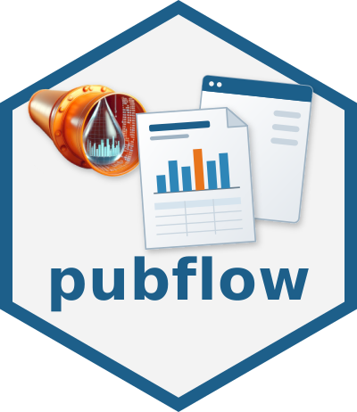

# pubflow 

<!-- badges: start -->
[](https://github.com/rpahl/pubflow/actions/workflows/R-CMD-check.yaml)
[](https://github.com/rpahl/pubflow/actions/workflows/lint.yaml)
<!-- badges: end -->

{pubflow} ("publishing workflow") is the companion package of
[pipeflow](https://github.com/rpahl/pipeflow): it takes the results a
pipeline computes and covers what is needed to *publish* them.

## Why pubflow?

Unlike knitr, rmarkdown and Quarto, a pubflow document is not a source file
to knit: the pipeline builds it, so it can update in place and feed a viewer
or a report.

- **Parameter UI for free**: Shiny inputs and validation built from a
  pipeline's params
- **Live preview**: see a change in the viewer without re-knitting the
  document
- **Only what changed**: documents are pipeline steps, so pipeflow re-runs
  just what a change affects
- **Same document, every format**: the same tables, figures and text in
  HTML, Word, PDF and Markdown
- **Traceable by design**: deterministic output with trace stamps and
  session info

## Status

Under development towards v0.1. The design is in [dev/DESIGN.md](dev/DESIGN.md),
the open work in [dev/PLAN.md](dev/PLAN.md).

## Example

A step returns a table, a layout step arranges it into a document, and
`pub_render()` writes the document to a Word file:

```r
library(pipeflow)
library(pubflow)

pip <- pip_new("my-pip") |>
    pip_add("fit", function(data = airquality, xVar = "Temp") {
        coefs <- coef(lm(paste("Ozone ~", xVar), data = data))
        data.frame(term = names(coefs), estimate = unname(coefs))
    }) |>
    pip_add("table", function(fit = ~fit) {
        pub_table(fit, caption = "Linear model of the ozone concentration",
                  digits = c(estimate = 3L))
    }) |>
    pip_add("report", function(table = ~table) {
        pub_doc(pub_section("Results", table), title = "Ozone in New York")
    })
pip_run(pip)
pub_render(pip[["report", "out"]], "docx")
```

The vignette `vignette("v01-get-started", package = "pubflow")` goes through
the whole flow: params, outputs, documents, report files and a Shiny app.

## Installation

```r
# install.packages("pak")
pak::pak("rpahl/pubflow")
```

System requirements: pandoc >= 3.6; for PDF output xelatex (default) or
typst. pubflow finds pandoc via the environment variable `PUBFLOW_PANDOC`,
then `RSTUDIO_PANDOC`, then the PATH; typst via `PUBFLOW_TYPST`, then the
PATH, then the typst bundled with Quarto. PDF via xelatex needs the LaTeX
packages of huxtable (`huxtable::install_latex_dependencies()`) and
pdflscape, fancyhdr, lastpage, float and newunicodechar (TinyTeX:
`tinytex::tlmgr_install(c("pdflscape", "fancyhdr", "lastpage", "float",
"newunicodechar"))`); pandoc finds xelatex on the PATH.

## Word reference documents

DOCX output uses pubflow's reference document
(`inst/templates/reference.docx`, built by `data-raw/reference_docx.R`). Its
styles and the bookmarks of the header and footer lines that your own
reference document must provide are listed in
`vignette("v06-reports", package = "pubflow")`.

## Development

The development library is managed with [renv](https://rstudio.github.io/renv/)
for R 4.5.3; start R in the repository root and run `renv::restore()` once.
R >= 4.3 is supported and checked on CI.

```bash
R -q -e "devtools::document()"
R -q -e "devtools::test()"
R -q -e "pkgload::load_all(quiet = TRUE); lintr::lint_package()"
R -q -e "rcmdcheck::rcmdcheck(args = '--no-manual', error_on = 'warning', check_dir = 'check')"
```
