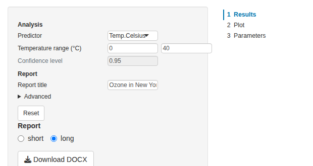

# Parameter UI and viewer in Shiny

[Get
started](https://rpahl.github.io/pubflow/articles/v01-get-started.md)
ended with a small Shiny app, and
[Parameters](https://rpahl.github.io/pubflow/articles/v02-parameters.md)
described the params that the app shows. This vignette goes through the
app in detail: the parameter UI and what it does with invalid input, the
viewer and how it shows failed steps, two reports from one pipeline of
which the app runs only the one shown, the render cache, and the two
Bootstrap versions. It builds on pipeflow’s vignettes [Pipeline
views](https://rpahl.github.io/pipeflow/articles/v03b-pipeline-views.html)
and [Error
handling](https://rpahl.github.io/pipeflow/articles/v05c-error-handling.html).

The code of the app is not run in the vignette, since it needs a
browser. The screenshots come from this very app. Two apps come with
pubflow: the report app combines all of it in an app with a sidebar and
adds the download of the report, the modules app shows what the modules
return, locked steps and a standalone module:

\
`shiny``::`[`runApp`](https://rdrr.io/pkg/shiny/man/runApp.html)`(`[`system.file`](https://rdrr.io/r/base/system.file.html)`(``"examples"``, ``"report-app"``, package ``=`` ``"pubflow"``)``)`\
`shiny``::`[`runApp`](https://rdrr.io/pkg/shiny/man/runApp.html)`(`[`system.file`](https://rdrr.io/r/base/system.file.html)`(``"examples"``, ``"modules-app"``, package ``=`` ``"pubflow"``)``)`

## The pipeline

The app shows the ozone analysis of the previous vignettes. The pipeline
has two reports: a short one with the summary and the table of
coefficients, and a long one that adds a plot and the table of
parameters. Every section of a report is a step, tagged with the reports
that show it, and the layout step of a report places the sections of its
tag
([`pub_layout_inputs()`](https://rpahl.github.io/pubflow/reference/pub_layout_inputs.md),
see [Get
started](https://rpahl.github.io/pubflow/articles/v01-get-started.md)).
The config has the params of the analysis, the title of the reports and
an advanced param.

\
[`library`](https://rdrr.io/r/base/library.html)`(`[`pipeflow`](https://rpahl.github.io/pipeflow/)`)`\
[`library`](https://rdrr.io/r/base/library.html)`(`[`pubflow`](https://rpahl.github.io/pubflow/)`)`\
\
`config`` ``<-`` `[`param_config`](https://rpahl.github.io/pubflow/reference/param_config.md)`(`\
`    xVar ``=`` `[`choice_param`](https://rpahl.github.io/pubflow/reference/param.md)`(`\
`        ``"Temp.Celsius"``,`\
`        choices ``=`` `[`c`](https://rdrr.io/r/base/c.html)`(``"Temp.Celsius"``, ``"Wind"``, ``"Solar.R"``)``,`\
`        label ``=`` ``"Predictor"``,`\
`        description ``=`` ``"Variable that explains the ozone concentration"``,`\
`        area ``=`` ``"analysis"``,`\
`        source ``=`` ``"user"`\
`    ``)``,`\
`    window ``=`` `[`param_group`](https://rpahl.github.io/pubflow/reference/param.md)`(`\
`        `[`list`](https://rdrr.io/r/base/list.html)`(`\
`            from ``=`` `[`numeric_param`](https://rpahl.github.io/pubflow/reference/param.md)`(``0``, label ``=`` ``"From"``, min ``=`` ``-``20``, max ``=`` ``60``)``,`\
`            to ``=`` `[`numeric_param`](https://rpahl.github.io/pubflow/reference/param.md)`(``40``, label ``=`` ``"To"``, min ``=`` ``-``20``, max ``=`` ``60``)`\
`        ``)``,`\
`        label ``=`` ``"Temperature range (°C)"``,`\
`        area ``=`` ``"analysis"``,`\
`        source ``=`` ``"user"`\
`    ``)`` ``|>`\
`        `[`add_validity`](https://rpahl.github.io/pubflow/reference/param_validity.md)`(``\``(``x``)`` ``if`` ``(``x``$``from`` ``<`` ``x``$``to``)`` ``""`` ``else`` ``"'From' must be below 'To'"``)``,`\
`    level ``=`` `[`numeric_param`](https://rpahl.github.io/pubflow/reference/param.md)`(`\
`        ``0.95``,`\
`        label ``=`` ``"Confidence level"``,`\
`        min ``=`` ``0.5``,`\
`        max ``=`` ``0.999``,`\
`        area ``=`` ``"analysis"``,`\
`        source ``=`` ``"user"`\
`    ``)``,`\
`    title ``=`` `[`param`](https://rpahl.github.io/pubflow/reference/param.md)`(`\
`        ``"Ozone in New York"``,`\
`        label ``=`` ``"Report title"``,`\
`        area ``=`` ``"report"``,`\
`        source ``=`` ``"user"`\
`    ``)``,`\
`    showPoints ``=`` `[`choice_param`](https://rpahl.github.io/pubflow/reference/param.md)`(`\
`        ``"yes"``,`\
`        choices ``=`` `[`c`](https://rdrr.io/r/base/c.html)`(``"yes"``, ``"no"``)``,`\
`        label ``=`` ``"Show the data points"``,`\
`        area ``=`` ``"report"``,`\
`        source ``=`` ``"user"``,`\
`        advanced ``=`` ``TRUE`\
`    ``)`\
`)`

The table, the plot and the table of parameters are made by functions
defined outside of the pipeline, so that the steps don’t keep the
pipeline’s environment alive (see Get started). A choice reaches a step
as a factor, so the plot converts `xVar` to text before it picks a
column with it.

\
`coef_table`` ``<-`` ``function``(``model``, ``level``)`` ``{`\
`    ``ci`` ``<-`` `[`confint`](https://rdrr.io/r/stats/confint.html)`(``model``, level ``=`` ``level``)`\
`    ``coefs`` ``<-`` `[`data.frame`](https://rdrr.io/r/base/data.frame.html)`(`\
`        term ``=`` `[`rownames`](https://rdrr.io/r/base/colnames.html)`(``ci``)``,`\
`        estimate ``=`` `[`coef`](https://rdrr.io/r/stats/coef.html)`(``model``)``,`\
`        lower ``=`` ``ci``[``, ``1L``]``,`\
`        upper ``=`` ``ci``[``, ``2L``]`\
`    ``)`\
`    `[`pub_table`](https://rpahl.github.io/pubflow/reference/pub_table.md)`(`\
`        ``coefs``,`\
`        caption ``=`` `[`sprintf`](https://rdrr.io/r/base/sprintf.html)`(``"Coefficients with %g%% confidence limits"``, ``100`` ``*`` ``level``)``,`\
`        labels ``=`` `[`c`](https://rdrr.io/r/base/c.html)`(`\
`            term ``=`` ``"Term"``,`\
`            estimate ``=`` ``"Estimate"``,`\
`            lower ``=`` ``"Lower"``,`\
`            upper ``=`` ``"Upper"`\
`        ``)``,`\
`        digits ``=`` `[`c`](https://rdrr.io/r/base/c.html)`(``estimate ``=`` ``3L``, lower ``=`` ``3L``, upper ``=`` ``3L``)`\
`    ``)`\
`}`\
\
`scatter_plot`` ``<-`` ``function``(``data``, ``xVar``, ``showPoints``)`` ``{`\
`    ``xVar`` ``<-`` `[`as.character`](https://rdrr.io/r/base/character.html)`(``xVar``)`\
`    ``grDevices``::`[`pdf`](https://rdrr.io/r/grDevices/pdf.html)`(``NULL``)`\
`    `[`on.exit`](https://rdrr.io/r/base/on.exit.html)`(``grDevices``::`[`dev.off`](https://rdrr.io/r/grDevices/dev.html)`(``)``)`\
`    ``grDevices``::`[`dev.control`](https://rdrr.io/r/grDevices/dev2.html)`(``"enable"``)`\
`    `[`plot`](https://rdrr.io/r/graphics/plot.default.html)`(`\
`        ``data``[[``xVar``]``]``,`\
`        ``data``$``Ozone``,`\
`        type ``=`` ``if`` ``(``showPoints`` ``==`` ``"yes"``)`` ``"p"`` ``else`` ``"n"``,`\
`        pch ``=`` ``19``,`\
`        xlab ``=`` ``xVar``,`\
`        ylab ``=`` ``"Ozone (ppb)"`\
`    ``)`\
`    `[`abline`](https://rdrr.io/r/graphics/abline.html)`(`[`lm`](https://rdrr.io/r/stats/lm.html)`(``data``$``Ozone`` ``~`` ``data``[[``xVar``]``]``)``, col ``=`` ``"red"``)`\
`    `[`pub_figure`](https://rpahl.github.io/pubflow/reference/pub_figure.md)`(`[`recordPlot`](https://rdrr.io/r/grDevices/recordplot.html)`(``)``, caption ``=`` ``"Ozone by predictor"``, width ``=`` ``6``, height ``=`` ``4``)`\
`}`\
\
`params_table`` ``<-`` ``function``(``pip``, ``xVar``, ``window``, ``level``, ``title``, ``showPoints``)`` ``{`\
`    ``# the arguments make the step run again when a reported param changes`\
`    `[`pub_params_table`](https://rpahl.github.io/pubflow/reference/pub_params_table.md)`(`[`pub_get_params`](https://rpahl.github.io/pubflow/reference/pub_get_params.md)`(``pip``, source ``=`` ``"user"``)``, caption ``=`` ``"Parameters"``)`\
`}`

\
`pip`` ``<-`` `[`pip_new`](https://rpahl.github.io/pipeflow/reference/pip_new.html)`(``"ozone"``)`` ``|>`\
`    `[`pip_add`](https://rpahl.github.io/pipeflow/reference/pip_add.html)`(``"data"``, ``function``(``data`` ``=`` ``airquality``)`` ``data``)`` ``|>`\
`    `[`pip_add`](https://rpahl.github.io/pipeflow/reference/pip_add.html)`(`\
`        ``"prep"``,`\
`        ``function``(``df`` ``=`` ``~``data``, ``window`` ``=`` `[`list`](https://rdrr.io/r/base/list.html)`(``from ``=`` ``0``, to ``=`` ``40``)``)`` ``{`\
`            ``df``[``, ``"Temp.Celsius"``]`` ``<-`` ``(``df``[``, ``"Temp"``]`` ``-`` ``32``)`` ``*`` ``5`` ``/`` ``9`\
`            ``inRange`` ``<-`` ``df``$``Temp.Celsius`` ``>=`` ``window``$``from`` ``&`` ``df``$``Temp.Celsius`` ``<=`` ``window``$``to`\
`            ``df``[``inRange``, ``]`\
`        ``}`\
`    ``)`` ``|>`\
`    `[`pip_add`](https://rpahl.github.io/pipeflow/reference/pip_add.html)`(``"fit"``, ``function``(``data`` ``=`` ``~``prep``, ``xVar`` ``=`` ``"Temp.Celsius"``)`` ``{`\
`        `[`lm`](https://rdrr.io/r/stats/lm.html)`(`[`paste`](https://rdrr.io/r/base/paste.html)`(``"Ozone ~"``, ``xVar``)``, data ``=`` ``data``)`\
`    ``}``)`` ``|>`\
`    `[`pip_add`](https://rpahl.github.io/pipeflow/reference/pip_add.html)`(``"coef_table"``, ``function``(``model`` ``=`` ``~``fit``, ``level`` ``=`` ``0.95``)`` ``{`\
`        ``coef_table``(``model``, ``level``)`\
`    ``}``)`` ``|>`\
`    `[`pip_add`](https://rpahl.github.io/pipeflow/reference/pip_add.html)`(``"summary"``, ``function``(``model`` ``=`` ``~``fit``, ``xVar`` ``=`` ``"Temp.Celsius"``)`` ``{`\
`        `[`pub_text`](https://rpahl.github.io/pubflow/reference/pub_text.md)`(`[`sprintf`](https://rdrr.io/r/base/sprintf.html)`(`\
`            ``"**%s** explains %.0f%% of the variance of the ozone concentration."``,`\
`            ``xVar``,`\
`            ``100`` ``*`` `[`summary`](https://rdrr.io/r/base/summary.html)`(``model``)``$``r.squared`\
`        ``)``)`\
`    ``}``)`` ``|>`\
`    `[`pip_add`](https://rpahl.github.io/pipeflow/reference/pip_add.html)`(`\
`        ``"scatter"``,`\
`        ``function``(``data`` ``=`` ``~``prep``, ``xVar`` ``=`` ``"Temp.Celsius"``, ``showPoints`` ``=`` ``"yes"``)`` ``{`\
`            ``scatter_plot``(``data``, ``xVar``, ``showPoints``)`\
`        ``}`\
`    ``)`` ``|>`\
`    `[`pip_add`](https://rpahl.github.io/pipeflow/reference/pip_add.html)`(`\
`        ``"params_table"``,`\
`        ``function``(`\
`            ``xVar`` ``=`` ``"Temp.Celsius"``,`\
`            ``window`` ``=`` `[`list`](https://rdrr.io/r/base/list.html)`(``from ``=`` ``0``, to ``=`` ``40``)``,`\
`            ``level`` ``=`` ``0.95``,`\
`            ``title`` ``=`` ``"Ozone in New York"``,`\
`            ``showPoints`` ``=`` ``"yes"`\
`        ``)`` ``{`\
`            ``params_table``(``.self``, ``xVar``, ``window``, ``level``, ``title``, ``showPoints``)`\
`        ``}`\
`    ``)`` ``|>`\
`    `[`pip_add`](https://rpahl.github.io/pipeflow/reference/pip_add.html)`(`\
`        ``"results"``,`\
`        ``function``(``summary`` ``=`` ``~`[`try`](https://rdrr.io/r/base/try.html)`(``summary``)``, ``table`` ``=`` ``~`[`try`](https://rdrr.io/r/base/try.html)`(``coef_table``)``)`` ``{`\
`            `[`pub_section`](https://rpahl.github.io/pubflow/reference/pub_doc.md)`(``"Results"``, ``summary``, ``table``)`\
`        ``}``,`\
`        tags ``=`` `[`c`](https://rdrr.io/r/base/c.html)`(``"short"``, ``"long"``)`\
`    ``)`` ``|>`\
`    `[`pip_add`](https://rpahl.github.io/pipeflow/reference/pip_add.html)`(`\
`        ``"plot"``,`\
`        ``function``(``scatter`` ``=`` ``~`[`try`](https://rdrr.io/r/base/try.html)`(``scatter``)``)`` `[`pub_section`](https://rpahl.github.io/pubflow/reference/pub_doc.md)`(``"Plot"``, ``scatter``)``,`\
`        tags ``=`` ``"long"`\
`    ``)`` ``|>`\
`    `[`pip_add`](https://rpahl.github.io/pipeflow/reference/pip_add.html)`(`\
`        ``"parameters"``,`\
`        ``function``(``table`` ``=`` ``~`[`try`](https://rdrr.io/r/base/try.html)`(``params_table``)``)`` `[`pub_section`](https://rpahl.github.io/pubflow/reference/pub_doc.md)`(``"Parameters"``, ``table``)``,`\
`        tags ``=`` ``"long"`\
`    ``)`

The layout steps come last, because
[`pub_layout_inputs()`](https://rpahl.github.io/pubflow/reference/pub_layout_inputs.md)
reads the tagged steps when it is called. Their inputs are `~try()`
references, so that a step that fails shows up as an error box in the
document instead of stopping it:

\
`for`` ``(``report`` ``in`` `[`c`](https://rdrr.io/r/base/c.html)`(``"short"``, ``"long"``)``)`` ``{`\
`    `[`pip_add`](https://rpahl.github.io/pipeflow/reference/pip_add.html)`(`\
`        ``pip``,`\
`        ``report``,`\
`        ``function``(``title`` ``=`` ``"Ozone in New York"``, ``...``)`` ``{`\
`            `[`pub_doc`](https://rpahl.github.io/pubflow/reference/pub_doc.md)`(`[`unname`](https://rdrr.io/r/base/unname.html)`(`[`list`](https://rdrr.io/r/base/list.html)`(``...``)``)``, title ``=`` ``title``)`\
`        ``}``,`\
`        params ``=`` `[`pub_layout_inputs`](https://rpahl.github.io/pubflow/reference/pub_layout_inputs.md)`(`[`pip_view`](https://rpahl.github.io/pipeflow/reference/pip_view.html)`(``pip``, tags ``=`` ``report``)``)`\
`    ``)`\
`}`\
\
[`invisible`](https://rdrr.io/r/base/invisible.html)`(`[`lapply`](https://rdrr.io/r/base/lapply.html)`(``config``, ``param_validity_assert``)``)`\
[`pip_set_params`](https://rpahl.github.io/pipeflow/reference/pip_set_params.html)`(``pip``, ``config``, unknown ``=`` ``"error"``)`

## The app

The app has the parameter UI in a sidebar and the viewer next to it. A
radio button chooses the report and a button downloads it.

\
[`library`](https://rdrr.io/r/base/library.html)`(`[`shiny`](https://shiny.posit.co/)`)`\
\
`ui`` ``<-`` `[`fluidPage`](https://rdrr.io/pkg/shiny/man/fluidPage.html)`(`\
`    `[`titlePanel`](https://rdrr.io/pkg/shiny/man/titlePanel.html)`(``"Ozone"``)``,`\
`    `[`sidebarLayout`](https://rdrr.io/pkg/shiny/man/sidebarLayout.html)`(`\
`        `[`sidebarPanel`](https://rdrr.io/pkg/shiny/man/sidebarLayout.html)`(`\
`            width ``=`` ``4``,`\
`            `[`pub_params_ui`](https://rpahl.github.io/pubflow/reference/pub_params_ui.md)`(``"params"``)``,`\
`            `[`radioButtons`](https://rdrr.io/pkg/shiny/man/radioButtons.html)`(``"report"``, ``"Report"``, `[`c`](https://rdrr.io/r/base/c.html)`(``"short"``, ``"long"``)``, inline ``=`` ``TRUE``)``,`\
`            `[`downloadButton`](https://rdrr.io/pkg/shiny/man/downloadButton.html)`(``"download"``, ``"Download DOCX"``)`\
`        ``)``,`\
`        `[`mainPanel`](https://rdrr.io/pkg/shiny/man/sidebarLayout.html)`(``width ``=`` ``8``, `[`pub_viewer_ui`](https://rpahl.github.io/pubflow/reference/pub_viewer_ui.md)`(``"viewer"``, height ``=`` ``"85vh"``)``)`\
`    ``)`\
`)`\
\
`server`` ``<-`` ``function``(``input``, ``output``, ``session``)`` ``{`\
`    ``pip`` ``<-`` `[`pip_clone`](https://rpahl.github.io/pipeflow/reference/pip_clone.html)`(``pip``)`` ``# every session gets its own pipeline`\
`    ``cache`` ``<-`` `[`pub_cache`](https://rpahl.github.io/pubflow/reference/pub_cache.md)`(``)`\
`    ``params`` ``<-`` `[`pub_pipeline_params_server`](https://rpahl.github.io/pubflow/reference/pub_params_ui.md)`(`\
`        ``"params"``,`\
`        ``pip``,`\
`        group_labels ``=`` `[`c`](https://rdrr.io/r/base/c.html)`(``analysis ``=`` ``"Analysis"``, report ``=`` ``"Report"``)``,`\
`        reset ``=`` ``TRUE`\
`    ``)`\
\
`    ``doc`` ``<-`` `[`reactive`](https://rdrr.io/pkg/shiny/man/reactive.html)`(``{`\
`        ``params``$``revision``(``)`` ``# run again after every change of a param`\
`        ``report`` ``<-`` ``input``$``report`\
`        `[`withCallingHandlers`](https://rdrr.io/r/base/conditions.html)`(`\
`            `[`pip_run`](https://rpahl.github.io/pipeflow/reference/pip_run.html)`(`[`pip_view`](https://rpahl.github.io/pipeflow/reference/pip_view.html)`(``pip``, step ``=`` ``report``)``, lgr ``=`` ``NULL``, on_error ``=`` ``"continue"``)``,`\
`            pipeflow_run_failed ``=`` ``function``(``w``)`` ``{`\
`                `[`showNotification`](https://rdrr.io/pkg/shiny/man/showNotification.html)`(`[`conditionMessage`](https://rdrr.io/r/base/conditions.html)`(``w``)``, type ``=`` ``"warning"``)`\
`                `[`message`](https://rdrr.io/r/base/message.html)`(`[`conditionMessage`](https://rdrr.io/r/base/conditions.html)`(``w``)``)`` ``# log it`\
`                `[`invokeRestart`](https://rdrr.io/r/base/conditions.html)`(``"muffleWarning"``)`\
`            ``}`\
`        ``)`\
`        ``pip``[[``report``, ``"out"``]``]`\
`    ``}``)`\
`    `[`pub_viewer_server`](https://rpahl.github.io/pubflow/reference/pub_viewer_ui.md)`(``"viewer"``, ``doc``, cache ``=`` ``cache``)`\
\
`    ``output``$``download`` ``<-`` `[`downloadHandler`](https://rdrr.io/pkg/shiny/man/downloadHandler.html)`(`\
`        filename ``=`` \``(``)`` `[`paste0`](https://rdrr.io/r/base/paste.html)`(``input``$``report``, ``".docx"``)``,`\
`        content ``=`` \``(``file``)`` ``{`\
`            `[`req`](https://rdrr.io/pkg/shiny/man/req.html)`(`[`inherits`](https://rdrr.io/r/base/class.html)`(``doc``(``)``, ``"pub_doc"``)``)`\
`            `[`pub_render`](https://rpahl.github.io/pubflow/reference/pub_render.md)`(``doc``(``)``, ``"docx"``, file ``=`` ``file``, cache ``=`` ``cache``)`\
`        ``}`\
`    ``)`\
`}`\
\
[`shinyApp`](https://rdrr.io/pkg/shiny/man/shinyApp.html)`(``ui``, ``server``)`

The app with the long report. The inputs are grouped by the `area` of
the params, and the advanced param is in the collapsed block.

The following sections go through the parts of the app.

## The parameter UI

[`pub_params_ui()`](https://rpahl.github.io/pubflow/reference/pub_params_ui.md)
places the table of inputs and
[`pub_pipeline_params_server()`](https://rpahl.github.io/pubflow/reference/pub_params_ui.md)
fills it. The server reads the params of the pipeline with
[`pub_get_params()`](https://rpahl.github.io/pubflow/reference/pub_get_params.md)
and shows an input for each one (plain function defaults are no params
and get no input). Every value that the user enters is checked against
the rules of the param (see
[Parameters](https://rpahl.github.io/pubflow/articles/v02-parameters.md))
and, if it is valid, set in the pipeline with
[`pip_set_params()`](https://rpahl.github.io/pipeflow/reference/pip_set_params.html).
The pipeline never gets an invalid value.

The type of a param decides on the input: text for strings, a numeric
input for numbers, a select input for factors (or radio buttons with
`ui_widget = "radio"`), a switch for logicals, and a slider with
`ui_widget = "slider"`. The children of a group are shown side by side.
The `ui_args` attribute passes arguments on to the input function,
e.g. `ui_args = list(multiple = TRUE)` for a select input that takes
several values.
[`?pub_param_input`](https://rpahl.github.io/pubflow/reference/pub_param_input.md)
lists them all and shows how to use a single input in your own UI.

The layout follows the config:

- The rows are in the order of the config.
- The attribute `group_by` (default `"area"`) gives the headings of the
  groups, named by `group_labels`. Without it, or if all params have the
  same value, there are no headings.
- A param with `advanced = TRUE` goes to a collapsed “Advanced” block of
  its group.
- The `description` of a param is shown as a tooltip of its input (with
  `tooltips = FALSE` it is not), and `width` sets the width of the
  inputs.
- `reset = TRUE` adds a button that sets the inputs back to the values
  that the table started with.

The table is only built again when the structure of the params changes.
If a step sets other values (e.g. defaults that depend on the data), the
inputs are updated in place. To pick this up, give the module a
`refresh` argument, a reactive that changes whenever the params should
be read again from the pipeline.

### Which params are shown

The module shows the params of the pipeline or view that it gets. A view
restricts the table to the params of the steps of the view, here the
steps of the analysis (a view shows the params of its own steps, not
those of the steps they depend on):

\
`analysis`` ``<-`` `[`pip_view`](https://rpahl.github.io/pipeflow/reference/pip_view.html)`(``pip``, step ``=`` `[`c`](https://rdrr.io/r/base/c.html)`(``"prep"``, ``"fit"``, ``"coef_table"``)``)`\
[`pub_pipeline_params_server`](https://rpahl.github.io/pubflow/reference/pub_params_ui.md)`(``"params"``, ``analysis``)`

The values still reach every step that has the param, also outside the
view (one value per name, see
[Parameters](https://rpahl.github.io/pubflow/articles/v02-parameters.html#one-value-per-name)).
With `filter = list(area = "analysis")` the table shows the params with
that attribute only. This is how an app puts the analysis params and the
report params into different places.

### Invalid input

An invalid value is shown next to its input, in a message that goes away
after a few seconds, and the input glows. The message is also written
with [`message()`](https://rdrr.io/r/base/message.html), so it ends up
in the log of the app. What happens to the input is up to `on_invalid`:

- `"restore"` (the default): the input gets back its last valid value.
- `"keep"`: the input keeps the invalid value, which does not reach the
  pipeline, until the user has corrected it. The module’s `valid()` is
  `FALSE` in the meantime, so the app can hold back what depends on it.

\
`params`` ``<-`` `[`pub_pipeline_params_server`](https://rpahl.github.io/pubflow/reference/pub_params_ui.md)`(``"params"``, ``pip``, on_invalid ``=`` ``"keep"``)`

Confidence level 1.5 with `on_invalid = "keep"`: the input glows and
shows the first message of the rule.

Text and numeric inputs report their value when the user leaves the
input or presses Enter (`update_on = "blur"`), other inputs immediately.
With `update_on = "change"` they report after every keystroke, after a
short delay.

If a group fails a rule of its own, e.g. “From” is not below “To”, the
input that the user changed is marked. And if the pipeline itself
rejects a value
([`pip_set_params()`](https://rpahl.github.io/pipeflow/reference/pip_set_params.html)
fails, because the pipeline holds stricter rules than the ones the
module read), the input is treated like an invalid one and shows the
value of the pipeline again.

### Locked inputs

A param with `locked = TRUE` is shown as a disabled input (see
[Parameters](https://rpahl.github.io/pubflow/articles/v02-parameters.html#locked-params)).
The module ignores a change that still reaches it, and the reset button
leaves it alone. pipeflow’s locks count too: the params of a step locked
with
[`pip_lock()`](https://rpahl.github.io/pipeflow/reference/pip_lock.html)
are shown as locked, also in the other steps that hold the same param,
because
[`pip_set_params()`](https://rpahl.github.io/pipeflow/reference/pip_set_params.html)
skips locked steps and a change would leave the steps with different
values.

\
[`pip_set_params`](https://rpahl.github.io/pipeflow/reference/pip_set_params.html)`(``pip``, `[`list`](https://rdrr.io/r/base/list.html)`(``level ``=`` `[`numeric_param`](https://rpahl.github.io/pubflow/reference/param.md)`(`\
`    ``0.95``,`\
`    label ``=`` ``"Confidence level"``,`\
`    min ``=`` ``0.5``,`\
`    max ``=`` ``0.999``,`\
`    area ``=`` ``"analysis"``,`\
`    source ``=`` ``"user"``,`\
`    locked ``=`` ``TRUE`\
`)``)``)`

The confidence level is locked.

### The module without a pipeline

[`pub_pipeline_params_server()`](https://rpahl.github.io/pubflow/reference/pub_params_ui.md)
is
[`pub_params_server()`](https://rpahl.github.io/pubflow/reference/pub_params_ui.md)
plus the link to a pipeline. The latter takes a reactive that returns
the params, e.g. a config, and gives you the values:

\
`params`` ``<-`` `[`pub_params_server`](https://rpahl.github.io/pubflow/reference/pub_params_ui.md)`(``"params"``, `[`reactive`](https://rdrr.io/pkg/shiny/man/reactive.html)`(``config``)``)`\
`params``$``values``(``)`` ``# the current valid values, as plain values`\
`params``$``changed``(``)`` ``# what changed with the latest valid change`\
`params``$``valid``(``)`` ``# FALSE if an input holds an invalid value (on_invalid = "keep")`

Use it where the params do not belong to a pipeline, e.g. for the
arguments of a function that you call in the app yourself.

## Running the pipeline

[`pub_pipeline_params_server()`](https://rpahl.github.io/pubflow/reference/pub_params_ui.md)
returns `revision`, a reactive that counts the successful changes of the
pipeline’s params. The reactive that runs the pipeline depends on it, so
that it runs again after every change.
[`pip_run()`](https://rpahl.github.io/pipeflow/reference/pip_run.html)
only runs the steps that are outdated, so a change of the title does not
fit the model again.

The pipeline is a reference object. A change of a param in one session
would also change it for every other session, so `server()` starts with
`pip_clone(pip)`: every session has its own copy.

### Only the steps of the report shown

The reactive runs the view of the report that is shown,
`pip_view(pip, step = report)`, not the whole pipeline. A view runs the
step and the steps it depends on. If the user shows the short report,
the plot and the table of parameters are not made. The step states show
it:

\
[`pip_run`](https://rpahl.github.io/pipeflow/reference/pip_run.html)`(`[`pip_view`](https://rpahl.github.io/pipeflow/reference/pip_view.html)`(``pip``, step ``=`` ``"short"``)``, lgr ``=`` ``NULL``)`\
`pip``[``, `[`c`](https://rdrr.io/r/base/c.html)`(``"step"``, ``"state"``)``]`\
`#             step  state`\
`#           <char> <char>`\
`#  1:         data   done`\
`#  2:         prep   done`\
`#  3:          fit   done`\
`#  4:   coef_table   done`\
`#  5:      summary   done`\
`#  6:      scatter    new`\
`#  7: params_table    new`\
`#  8:      results   done`\
`#  9:         plot    new`\
`# 10:   parameters    new`\
`# 11:        short   done`\
`# 12:         long    new`

Everything of the long report that the short report does not need is
still `new`. Switching to the long report runs the missing steps
(`scatter`, `params_table`, `plot`, `parameters` and the layout step),
while the steps of the short report are not run again.

### Failed steps

Run the pipeline with `on_error = "continue"`. A step that fails does
not stop the run, and the steps that depend on it are not run, but the
layout step still builds the document. It places the failure where the
output would have been, and the viewer shows it as an error box. The run
signals one warning for all failed steps (`pipeflow_run_failed`); the
app shows it as a notification and logs it.

To see this in the app, set the end of the temperature range (“To”) to
1: no row of the data is left, so the model and the plot fail.

The temperature range ends at 1. The failed steps show as error boxes,
the table of parameters still works.

If the layout step itself fails, its output is the error, and the viewer
shows it as one box: pass `pip[[report, "out"]]` on as it is, as in the
app above. An error is never embedded silently in a document.

## The viewer

[`pub_viewer_ui()`](https://rpahl.github.io/pubflow/reference/pub_viewer_ui.md)
and
[`pub_viewer_server()`](https://rpahl.github.io/pubflow/reference/pub_viewer_ui.md)
show a document as one scrollable page, with a table of contents that
follows the section being read. The server takes a reactive that returns
the document, `NULL` (shows “No results”) or an error.

- `toc = FALSE` hides the table of contents.
- `height = NULL` lets the viewer grow with the document and the page
  scrolls. With a CSS height, e.g. `"85vh"` as above, the viewer has
  that height and scrolls itself.

The viewer renders the document again as a whole when it changes.
Figures and tables are not made again for that, they come from the
render cache.

### The render cache

Rendering a figure takes about 0.1 s, and the viewer would repeat that
for each figure after every change of a param.
[`pub_cache()`](https://rpahl.github.io/pubflow/reference/pub_cache.md)
holds the rendered figures (as files) and the HTML of the tables, and
the viewer and the render functions use it when they get it as `cache`.
So a report downloaded after viewing needs not render its figures again:
the app above gives the same cache to the viewer and to
[`pub_render()`](https://rpahl.github.io/pubflow/reference/pub_render.md).

\
`cache`` ``<-`` `[`pub_cache`](https://rpahl.github.io/pubflow/reference/pub_cache.md)`(``)`\
[`pub_viewer_server`](https://rpahl.github.io/pubflow/reference/pub_viewer_ui.md)`(``"viewer"``, ``doc``, cache ``=`` ``cache``)`\
[`pub_render`](https://rpahl.github.io/pubflow/reference/pub_render.md)`(``doc``(``)``, ``"docx"``, file ``=`` ``file``, cache ``=`` ``cache``)`

[`pub_cache()`](https://rpahl.github.io/pubflow/reference/pub_cache.md)
is an environment, so it is updated in place. By default it is kept in a
new temporary directory of the R session, `max_entries` limits it (the
least recently used entries and their files are removed beyond that),
and `dir` puts the files elsewhere. A figure is only cached if a step
made it: pipeflow stamps it when the step runs, and the stamp is part of
the key. The cache therefore never shows a stale figure after a step ran
again. Make the cache in `server()`, as above, for one cache per
session, or outside of it to share the entries between sessions.

## Bootstrap 3 and 5

The modules work with Bootstrap 3, which
[`shiny::fluidPage()`](https://rdrr.io/pkg/shiny/man/fluidPage.html)
uses, and with Bootstrap 5, which bslib’s page functions use. The app
above runs on both by changing the page:

\
`ui`` ``<-`` ``bslib``::`[`page_fluid`](https://rstudio.github.io/bslib/reference/page.html)`(`\
`    ``# the same layout as before`\
`)`

Nothing else changes: the modules bring their own JavaScript and CSS (as
an HTML dependency), also for the tooltips of the inputs. The screenshot
of the failed steps above is a Bootstrap 5 page, the others are
Bootstrap 3. The example apps show both: add `?bs=5` to their URL.

## Where next

- [Get
  started](https://rpahl.github.io/pubflow/articles/v01-get-started.md)
  shows the workflow in one example,
  [Parameters](https://rpahl.github.io/pubflow/articles/v02-parameters.md)
  the params in depth.
- The help pages of the functions describe the options:
  [`?pub_params_ui`](https://rpahl.github.io/pubflow/reference/pub_params_ui.md),
  [`?pub_param_input`](https://rpahl.github.io/pubflow/reference/pub_param_input.md),
  [`?pub_viewer_ui`](https://rpahl.github.io/pubflow/reference/pub_viewer_ui.md),
  [`?pub_cache`](https://rpahl.github.io/pubflow/reference/pub_cache.md).
