# pubflow — architecture overview

Audience: developers (human or agent) who want to understand how pubflow's
parts fit together before working on it.
Companion documents: `DESIGN.md` is the agreed design with the reasons
(decision log D1-D55); `PLAN.md` the open work; `reference/` the research
behind both. This document is the map: what the parts are, how data flows
between them and where to look in the code. It cites decisions (D) instead
of repeating them; "§n below" refers to this document.
The exported functions, grouped by task, are listed in the reference index
of `_pkgdown.yml`.

Diagrams are Mermaid (rendered by GitHub and VS Code). Internal helpers
(names starting with `.`) are named where they are the entry point of a
part.

## Contents

- [1. pubflow in one picture](#1-pubflow-in-one-picture)
- [2. Source map](#2-source-map)
- [3. Lifecycle of a value: from config to deliverable](#3-lifecycle-of-a-value-from-config-to-deliverable)
- [4. Parameter UI (`ui_params_module.R`, `ui_param_input.R`)](#4-parameter-ui-ui_params_moduler-ui_param_inputr)
- [5. Outputs and the document tree (`output.R`, `doc.R`)](#5-outputs-and-the-document-tree-outputr-docr)
- [6. Rendering](#6-rendering)
- [7. Failures and errors](#7-failures-and-errors)
- [8. Invariants to keep](#8-invariants-to-keep)
- [9. Where to change what](#9-where-to-change-what)
- [10. Tests and fixtures](#10-tests-and-fixtures)
- [Keeping this document current](#keeping-this-document-current)

---

## 1. pubflow in one picture

pipeflow computes; pubflow publishes. An app builds a
pipeflow pipeline whose parameters are pubflow **param objects**, lets users
edit them in a **param UI**, runs the pipeline, and a **layout step** of
the pipeline arranges step outputs into a **document**. The document is
plain data: the **viewer** shows it in Shiny, `pub_render()` writes it as
HTML, DOCX, PDF or Markdown.

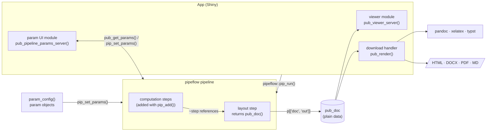

Three rules shape everything else:

- **pubflow never runs a pipeline** (D19). Apps (or tests) call
  `pipeflow::pip_run()`; pubflow provides the pieces around it.
- **Step functions never see param objects**. pipeflow unwraps them through
  pubflow's `pip_param_value.param()` method.
- **A document holds outputs only**: no pipeline and no Shiny session is
  needed to render it, and it survives `saveRDS()` (D20).

---

## 2. Source map

The code falls into eight parts. Arrows point from a part to the parts it
uses; `errors.R` (the `pubflow_*` conditions) and `utils.R` (small helpers)
are used by all of them.
Every `R/<file>.R` (except `pubflow-package.R`) has
`tests/testthat/test-<file>.R`.

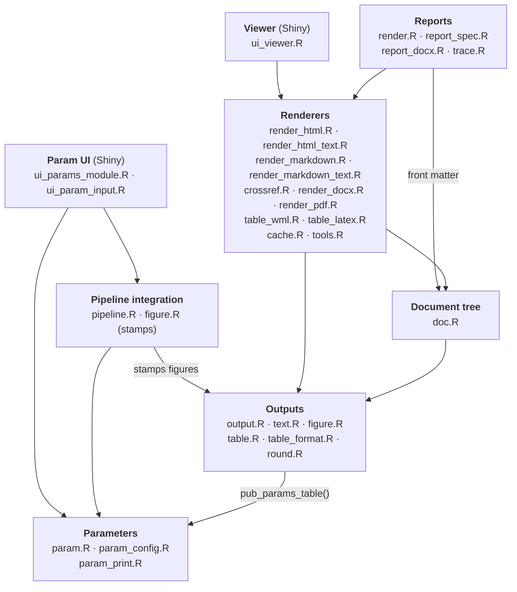

| File | Role | Entry points |
|---|---|---|
| `param.R` | param objects, values, validity | `param()`, `*_param()`, `param_group()`, `param_value()`, `` `param_value<-` ``, `param_validity()` |
| `param_config.R` | ordered configs | `param_config()`, `c()`, `[` |
| `param_print.R` | printing params | `print.param()` |
| `pipeline.R` | params in pipelines, reading parts | `pub_get_params()`, `pub_out()`, `pub_layout_inputs()`, `pub_layout_sections()`, `pip_param_value.param()`, `` `pip_param_value<-.param`() `` |
| `ui_params_module.R` | param UI server logic | `pub_params_ui()`, `pub_params_server()`, `pub_pipeline_params_server()`; `.params_module()` |
| `ui_param_input.R` | widgets and the params table | `pub_param_input()`, `.widget()`, `.params_table()`, `.pubflow_dependency()` |
| `output.R` | metadata, output types, small content nodes | `pub_meta()`, `pub_set_meta()`, `pub_type()`, `as_pub_output()`, `pub_raw()`, `pub_toc()`, `pub_pagebreak()`, `pub_session_info()` |
| `text.R` | Markdown text outputs, escaping data for Markdown | `pub_text()`, `.check_markdown()`, `pub_md_escape()` |
| `figure.R` | figure outputs and devices | `pub_figure()`, `.render_figure()` |
| `table.R` | building and finishing tables | `pub_table()`, `pub_table_rows()`, `pub_strikeout()`, `pub_table_theme()`, `pub_params_table()` |
| `table_format.R` | the common cell formatter | `.format_cells()`, `.display_huxtable()`, `pub_cell_text()` |
| `round.R` | rounding half away from zero | `pub_round()`, `pub_format_num()`, `.round_decimal()` |
| `doc.R` | document tree, placing outputs | `pub_doc()`, `pub_section()`, `.expand_output()` |
| `render_html.R` | HTML renderer | `pub_html()`, `.html_parts()`, `.figure_file()` (shared with the Pandoc path) |
| `render_html_text.R` | Markdown text → HTML | `.markdown_html()` |
| `render_markdown.R` | Pandoc Markdown per target, Markdown files, pandoc calls | `pub_markdown()`, `.markdown_doc()`, `.md_item()`, `.render_md()`, `.run_pandoc()` |
| `render_markdown_text.R` | Markdown text → Pandoc input, escaping | `.markdown_pandoc()`, `.pandoc_reader()` |
| `crossref.R` | cross-references `@fig:`/`@tab:` (D44): targets, problems, per-target writers | `.ref_state()`, `.protect_refs()`, `.insert_refs()` |
| `render_docx.R` | DOCX files: page setup, section breaks | `.render_docx()`, `.docx_complete_sections()` |
| `render_pdf.R` | PDF via xelatex or typst | `.render_pdf()`, `.run_typst()`, `.check_latex_math()` |
| `table_wml.R` | native Word tables | `.huxtable_to_wml()` |
| `table_latex.R` | LaTeX/Typst tables, LaTeX widths | `.table_latex()`, `.table_typst()` |
| `cache.R` | render cache | `pub_cache()`, `.cache_key()`, `.cache_table_key()` |
| `tools.R` | finding pandoc and typst | `.find_pandoc()`, `.find_typst()` |
| `render.R` | rendering files | `pub_render()`, `pub_output_filename()` |
| `report_spec.R` | report specs, page setup | `pub_report_spec()`, `pub_page()`, `.render_settings()`, `.front_nodes()` |
| `report_docx.R` | DOCX post-processors | `pub_pp_docx_header_footer()`, `pub_pp_docx_lock()` |
| `trace.R` | trace stamp | `pub_trace_stamp()` |
| `ui_viewer.R` | viewer module | `pub_viewer_ui()`, `pub_viewer_server()` |
| `errors.R` | condition constructors | `.pubflow_error()`, `.render_error()`, ... |
| `utils.R` | small helpers used across the package | `%||%`, `.is_positive_number()` |

**Sections.** The files are split into commented sections. A full-width
banner (`# ====…`) opens a top-level block, and a short rule that is as long
as its title (`# ---…`) opens a section within it; small files have sections
only, and the shortest (`errors.R`, `text.R`, `trace.R`, `utils.R`) none.
In a section the exported function comes first, then its helpers in the
order they are called; helpers used by several blocks go into a last
"Helpers" block, and helpers used by several files into `utils.R`. The test
file `test-<file>.R` follows the banners and sections of its source file in
the same order, so the tests of a function are in the section of the same
name. Sections without tests are left out, tests that span a file (e.g.
cross-format consistency, report-like tables) come last under "Scenarios",
and a test file with a single section has no rules. To print the outline of
a file with line numbers, run

```sh
awk '/^# [-=]+$/ && p ~ /^# [^-=]/ && pp ~ /^# [-=]+$/ { print FNR - 1 ":" (/=/ ? " " : "   ") substr(p, 3) } { pp = p; p = $0 }' R/render_markdown.R
```

Other parts of the repository:

| Path | Content |
|---|---|
| `inst/www/` | `pubflow.js`/`.css` (param UI: inline messages, warn glow, tooltips), `pubflow-viewer.js`/`.css` (TOC sidebar, scrollspy, MathJax after updates), `pubflow-doc.css` (document typography, used by viewer and HTML files) |
| `inst/templates/` | `reference.docx` (styles and header/footer bookmarks; built by `data-raw/reference_docx.R`), `pubflow-header.tex` (LaTeX packages, error frame, footer), `pubflow.typ` (Typst template) |
| `inst/examples/report-app/` | report app: param UI in the sidebar, viewer with a short and a long report of one pipeline selected by tags (`pub_layout_inputs()`), download as DOCX/PDF/HTML with `pub_render()` (Bootstrap 3, `?bs=5` for Bootstrap 5) |
| `inst/examples/modules-app/` | modules app: the param modules' return values as raw R output, refresh, locked steps, a standalone module (Bootstrap 3, `?bs=5` for Bootstrap 5) |
| `inst/bench/` | benchmark scripts behind (workload R15 from `r15.R`) |
| `vignettes/` | user guides `vNN-*.Rmd` (knitr, built by R CMD check and pkgdown; the plan of the series is in `PLAN.md`) |
| `tests/testthat/helper-*.R` | shared fixtures: demo pipelines of every pattern, report-like tables, Shiny message capture (see §10 below) |

---

## 3. Lifecycle of a value: from config to deliverable

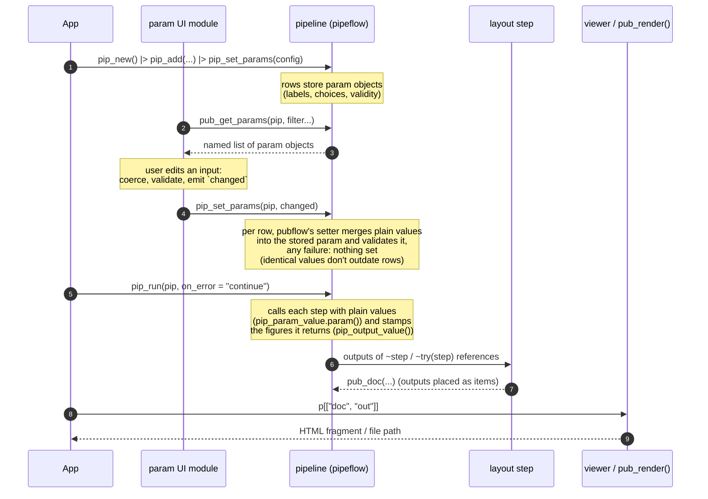

### 3.1 Parameters (`param.R`, `param_config.R`)

A param is its value with attributes (`label`, `description`, `validity`,
`source`, `area`, `min`, `max`, `ui_widget`, ...) and class
`c("param", <class of value>)`, so base operations keep working.
Groups (`param_group()`) are named lists of params with their own
validity (cross-field rules). `param_config()` flattens params into an
ordered, uniquely named list and stamps `order`, which drives the UI order.

Key functions: `param_value()` (plain value, recursive for groups),
`` `param_value<-` `` (converts a new value to the param's class, keeps
the attributes; this is the merge used everywhere), `param_validity()`.

### 3.2 Pipeline integration (`pipeline.R`)

pipeflow has no notion of params; pubflow adds it on top of the per-step
params of a pipeline (`x[["params"]]`, one row per step):

| pubflow | pipeflow underneath | What pubflow adds |
|---|---|---|
| `pub_get_params()` | `pip_get_params(simplify = FALSE)` (params grouped by name, named by step) | first occurrence that **is a param** (not a plain default of an earlier step), attribute filters, config order |
| `` `pip_param_value<-.param`() `` | generic `` `pip_param_value<-`() ``, used by `pip_set_params()` | merges a plain value into the param stored in a row and validates it (`pubflow_invalid_param`; pipeflow collects all into one `pipeflow_set_params_error` and sets nothing); configs are applied with `pip_set_params(x, config, unknown = "error")` (D36) |
| `pub_out()` | `x[[step, "out"]]`, step state | the output only if the step is "done" (a failed run leaves old outputs behind); else a `pubflow_not_done` error naming the pipeline and failed steps, or an error item (D34) |
| `pub_layout_inputs()` | views (`pip_view(tags = )`), `~try(step)` references | `~try(step)` for each step of a view, as `params` of a layout step taking `...`: tags select what a report shows (D39) |
| `pub_layout_sections()` | views (`pip_view()`), `~try(step)` references | the function of a layout step with one section per view (D55) |
| `pip_param_value.param()` | generic `pip_param_value()` | step functions receive plain values |

Nested pipelines need no function of pubflow: the inner pipeline becomes
the function of an outer step with pipeflow's `as.function()`, added with
`pip_add()`, and its param objects become params of
the outer step (D37).

### 3.3 Figure stamps (`figure.R`)

Steps are added with pipeflow's `pip_add()` (D38); pubflow hooks into the
step outputs only to **stamp figures** (step, partition key, run time), so
the render cache can tell them apart (D22):

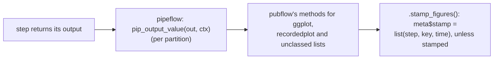

pipeflow calls step functions with plain values and releases `.self`
when a step returns, so outputs such as ggplots don't keep the pipeline
alive (D20).

---

## 4. Parameter UI (`ui_params_module.R`, `ui_param_input.R`)

Two layers: `pub_params_server()` works on any reactive list of params;
`pub_pipeline_params_server()` connects it to a pipeline or a view.

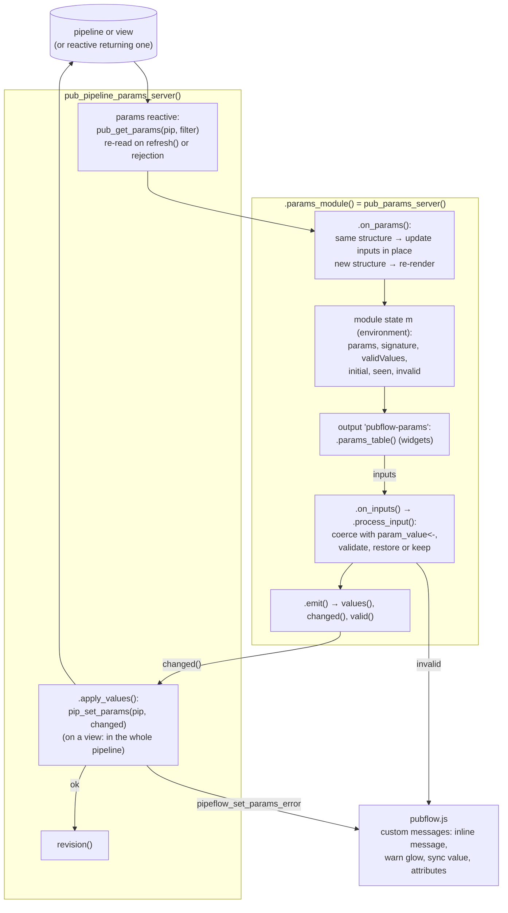

Points to know before changing it (details in):

- **Render once per structure.** `.structure_signature()` (names, order,
  attributes except validity) decides between re-render and in-place
  update; data-derived values (e.g. a limit read from data) update the
  inputs without flicker.
- **Change detection** compares the raw input with the last processed one
  (`m$seen`), so a re-render doesn't count old values as changes. Every
  value the server sets is followed by `syncInputValue`, one message per
  param that sets its inputs in one tick with the default priority (not
  `"event"`, which Shiny sends at once per value), so the children of a
  group reach the server together.
- **Views set the whole pipeline.** Given a view, the UI shows the params
  of the view's steps, but `pip_set_params()` sets their values in every
  step of the pipeline that has them (D46). A rejection can therefore come
  from a step outside the view: `.apply_values()` checks the value with
  the param object of the step named in the error.
- **Locked params** (attribute `locked`, also set by `.mark_step_locks()`
  in `pub_pipeline_params_server()` for names of locked steps, D48):
  `.disable_input()` wraps the input in a disabled `fieldset`;
  `.evaluate_input()` ignores their changes (`.ignore_locked_input()`),
  `.on_reset()` skips them.
- **No Shiny internals.** All client effects go through
  `.send_custom_message()` (a no-op without a session); tests record them
  through `session$rootScope()` (`helper-shiny.R`).
- Widget choice is a table on `param_type()` with overrides `ui_widget` /
  `ui_args` (`.widget()`, `.widget_fun()`).

---

## 5. Outputs and the document tree (`output.R`, `doc.R`)

### 5.1 Outputs

Any step output is an ordinary R object; optional metadata lives in **one
attribute** `attr(x, "pubflow")` (`pub_meta()`, `pub_set_meta()`; D6).
`pub_type()` classifies outputs:

| Object | Type | Notes |
|---|---|---|
| `huxtable`, `data.frame`, `matrix` | table | data frames become `pub_table()` when placed |
| `ggplot`, `recordedplot`, `pub_png`, image paths from `pub_figure()` | figure | `pub_png`: plot rendered in the step (D43) |
| character | text | Markdown subset |
| `htmlwidget` | widget | HTML only, `fallback` figure elsewhere |
| `pub_raw`, `pub_pagebreak`, `pub_toc` | raw, pagebreak, toc | |
| `pipeflow_failure`, `pub_error` | error | failed input of a layout step (D21), or a failed part from `pub_out(on_error = "item")` (D34) |
| plain or partitioned list | list | container: named → sections |
| `pub_section` | section | |
| `NULL` | null | skipped |
| anything else | `as_pub_output()` | S3 generic for adapters |

### 5.2 Documents

The constructors `pub_doc()` and `pub_section()` **place their children
immediately** (`.as_children()` → `.expand_output()`), so a document never
holds raw outputs, only nodes:

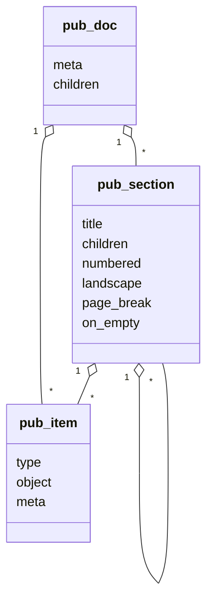

`pub_doc$meta` holds `title`, `subtitle`, `author`, `time`, `app`,
`version`, `header`, `footer` and free entries; an item's `type` is one of
the types above (table, figure, text, widget, raw, pagebreak, toc, error),
its `object` the output itself and its `meta` a copy of `pub_meta(object)`.

Placement rules: a named list becomes one sub-section per element
(recursively; also partitioned outputs, one section per key); an unnamed
list a sequence of items; an empty section follows its `on_empty`; a
failure object becomes an error item; a pipeline is an error. Layout steps
are ordinary steps that return `pub_doc()`, `pub_section()` or a list:

```r
p |> pip_add("doc", \(table = ~try(fit_table), plot = ~try(trend_plot)) {
    pub_doc(pub_section("Results", table, plot), title = "Report")
})
```

Patterns for groups of data:

| Pattern | When | How the document is made |
|---|---|---|
| split/reduce exec modes | one param set, per-group steps inside one pipeline | a per-partition layout step returns one section per partition, a `reduce` layout step places them |
| nested pipelines (`as.function()` of the inner pipeline; D37) | one param set, groups computed together | the inner pipeline's layout step makes a part (one of the steps in `out`), the outer one (exec `"reduce"`) places it for each group |
| independent pipelines (D34) | groups with their own params, UI or runs (e.g. one worker each) | each pipeline's layout step makes its part; a report pipeline gets the parts read with `pub_out()` as param values and assembles them |

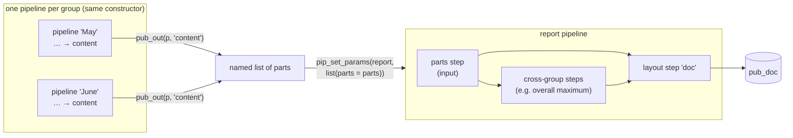

Parts that didn't change outdate nothing in the report pipeline (pipeflow
skips identical param values), so only the affected steps re-run.

---

## 6. Rendering

### 6.1 Two paths

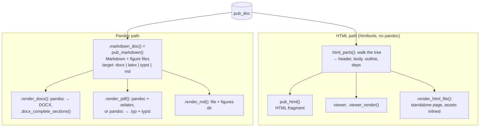

Both renderers **walk the tree with a render context** (`ctx`, an
environment): it counts tables and figures for captions, collects the
outline/dependencies (HTML) or the Markdown blocks and the page state
(Pandoc: orientation, pending page breaks, written lazily before the next
content). Numbers come from the tree at render time, never from the
pipeline. The HTML is built as strings for speed and stable
snapshots.

### 6.2 `pub_render()` (`render.R`)

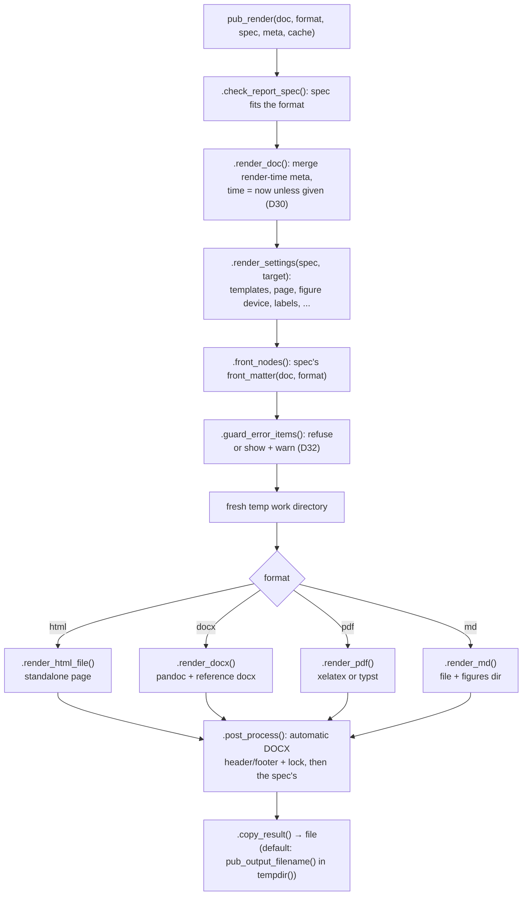

The **report spec** (`pub_report_spec()`) is the per-deliverable
configuration: templates, front matter, table of contents, page, figure
device, caption labels, locking, error items, post-processors, extra
pandoc arguments. `.render_settings()` resolves it for one target, so the
renderers only read a flat settings list.

DOCX **post-processors** (`report_docx.R`, D33) edit the finished file
with xml2 + zip: `pub_pp_docx_header_footer()` fills the header/footer
bookmarks of the reference document (with `{trace}` →
`pub_trace_stamp()`), `pub_pp_docx_lock()` wraps the header/footer content
in locked content controls (`pub_markdown()` writes those of the tables and
figures itself).

External tools are found by `tools.R` (`PUBFLOW_PANDOC`, RStudio's pandoc,
PATH; `PUBFLOW_TYPST`, PATH, Quarto's bundled typst); a missing one is a
`pubflow_tool_missing` error.

### 6.3 Tables: one formatter for every format

GMP requires identical cell text in every output (D15). Tables are
huxtables whose body cells store **text** (numbers with 15 significant
digits) plus a per-cell `number_format`; the text is produced only at
render time, by one formatter:

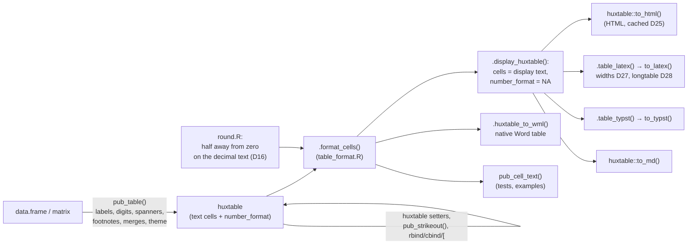

So: steps return unrounded numbers; styling and combining use huxtable's
own API (D18); writers never format values themselves; step code that
needs the same rounding uses `pub_round()` / `pub_format_num()`.

### 6.4 Figures and the render cache (`figure.R`, `cache.R`)

Rendering a ggplot costs ~80-100 ms, so figures (files) and table HTML
(in memory) are cached per session in a `pub_cache()` shared by the viewer
and the reports.

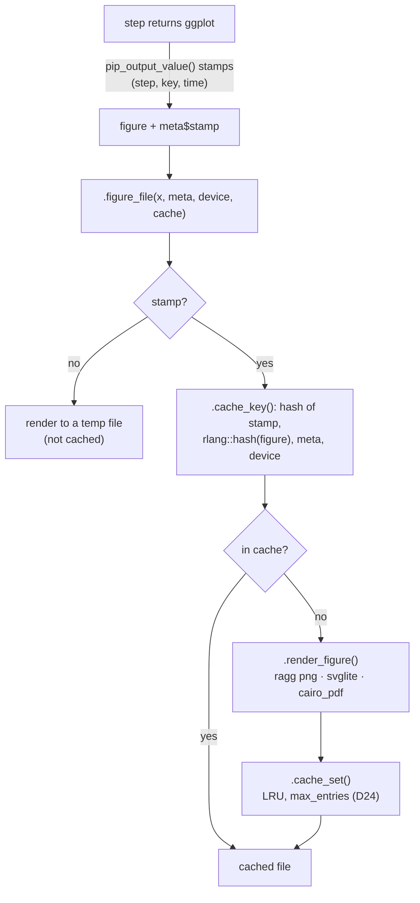

The stamp is needed because `rlang::hash()` hashes environments by
address, which R reuses (D22). The device settings are part of the key;
the viewer and every format default to png at 200 dpi (D40), so a report
after viewing reuses the viewer's entries.

`pub_figure(render = TRUE)` (D43) moves the rendering into the step: a ggplot or
recorded plot becomes a `pub_png` (PNG bytes with the metadata, `.render_png()`).
The output hook leaves it alone, and `.figure_file()` writes its bytes as `.png` for
any device (`.write_png()`) without the cache. The bytes survive `saveRDS()` and
workers, so a copy of a pipeline renders nothing again.

### 6.5 Text

Text items are a fixed Markdown subset. User input reaches texts
(param values), so both paths escape: raw HTML is shown literally (D23),
and on the Pandoc path texts are read as CommonMark with only the
extensions pubflow's own markup needs, with braces and fenced-div starts
escaped and LaTeX math checked by pandoc's math parser before TeX sees it
(D26). Converters: `render_html_text.R` (commonmark → HTML, math and
placeholders protected as tokens) and `render_markdown_text.R` (text →
Pandoc input per target).

**Cross-references** (`crossref.R`, D44): before a walk, `.ref_targets()`
collects the tables and figures with an `id` (front matter and body) and
`.ref_check()` the references of every text against them (error in reports,
warning in `pub_html()`/viewer). References are a token kind of the text
converters: LaTeX and Typst write engine references to the items' labels;
HTML, DOCX and md write a token that `.insert_refs()` replaces after the walk
with the caption number the walk recorded (so forward references work).

### 6.6 Viewer (`ui_viewer.R`)

`pub_viewer_server(id, doc, cache)` renders `doc()` with `.html_parts()`
into `output$doc` and the outline into `output$toc` (one reactive, ids
prefixed with the module namespace). `NULL` shows "No results", a
condition (the layout step failed) one error box. The client side
(`pubflow-viewer.js`) only does scrollspy and MathJax typesetting after
updates. There are no per-item modules or observers: a changed document is
rendered again as a whole, with figures and tables from the cache.

### 6.7 The Markdown dialect and the formats (`render_markdown.R`, `render.R`)

Details that the user documentation of `pub_markdown()` and `pub_render()`
leaves out (D26, §8.4):

- **DOCX target**: Markdown for pandoc's DOCX writer with pubflow's reference
  document; read with pandoc's `commonmark` reader plus the extensions
  `raw_attribute`, `tex_math_dollars`, `bracketed_spans`, `fenced_divs` and
  `attributes`. Numbered headings, the Word styles of unnumbered headings,
  item titles, captions and error items are `custom-style` divs, tables raw
  Word XML (native table writer), captions have `SEQ` fields, landscape parts
  raw section breaks, the table of contents a field; tables and figures to
  lock sit in locked content controls. The document header is passed to
  pandoc as metadata; after pandoc, `.docx_complete_sections()` completes
  the section breaks and the post-processors run (D33).
- **LaTeX and Typst targets**: unnumbered headings marked `{.unnumbered}`
  (pandoc numbers the others), tables via `huxtable::to_latex()` and
  `to_typst()` (LaTeX column widths from the cell texts), raw markup for
  placeholders, landscape parts, page breaks, tables of contents and error
  items; read with the DOCX reader plus `implicit_figures`.
- **Math in LaTeX**: pandoc's math parser (texmath) checks every formula in
  an extra run; unreadable formulas and macro definitions are a
  `pubflow_render_error`, because TeX commands could read files on the
  server (D26).
- **`md` target**: YAML front matter, `huxtable::to_md()` tables.
- **DOCX locks**: content controls of type `sdtContentLocked` (neither
  editable nor deletable) with the tags `locked-header`, `locked-footer`
  (post-processor; ids follow the largest id in the file) and `locked-table`,
  `locked-figure` (written by `pub_markdown()` without id, Word adds one on
  save). `pub_pp_docx_header_footer()` replaces the content of the bookmark
  `header_left` ... `footer_right` and takes the run properties of the first
  run in it that has some.
- **PDF details**: tables repeat their header rows; Typst with pandoc < 3.13
  turns `--` and `...` into a dash and an ellipsis.
- **Typst lookup**: `PUBFLOW_TYPST` (executable or directory), PATH,
  Quarto's installation (`QUARTO_PATH` or PATH); see `tools.R`.

---

## 7. Failures and errors

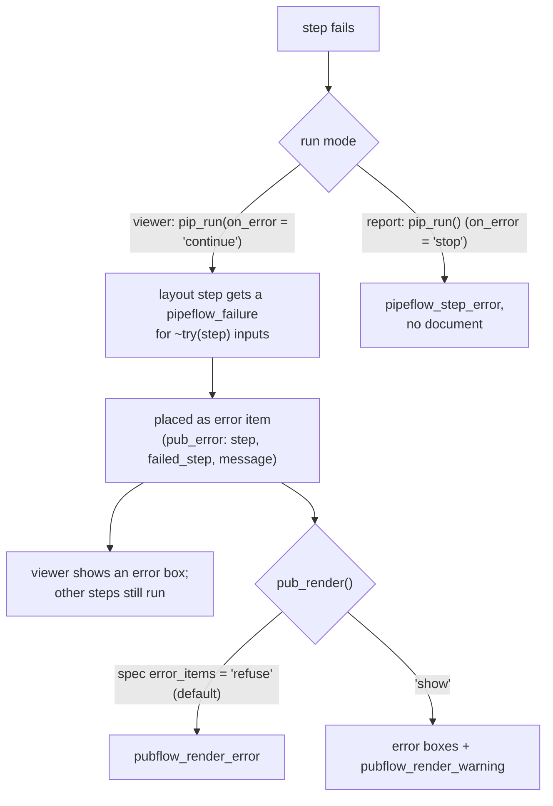

All pubflow conditions are rlang errors of class `pubflow_error` plus a
specific class (`errors.R`): `pubflow_invalid_param`,
`pubflow_render_error`, `pubflow_tool_missing`,
`pubflow_unsupported_output`, `pubflow_pipeline_output`,
`pubflow_not_done` (`pub_out()` of a step that isn't done). Step errors stay
pipeflow's (`pipeflow_step_error` with the step's own condition as
`parent`). Argument checks use plain `rlang::abort()`.

---

## 8. Invariants to keep

Each of these is tested; breaking one usually breaks a GMP or user
requirement.

| Invariant | Where | Why |
|---|---|---|
| Step functions get plain values | `pip_param_value.param()` | param attributes leak into results (lesson 1) |
| Same doc + spec → identical Markdown/HTML | renderers | determinism; time only from meta |
| Identical table cell text in every format | `.format_cells()` | D15, D16 |
| Documents don't reach the pipeline | pipeflow, `doc.R` | D20; `reaches_pipeline()` in tests |
| Errors never silently in deliverables | `.guard_error_items()` | D21, D32 |
| Times formatted with `tz = "UTC"` | everywhere | DESIGN.md §3 |
| No S3 methods for base classes, no options set on load, no Shiny internals, no per-session package state | everywhere | AGENTS.md hard rules |
| `huxtable::` prefix, no huxtable subclasses | table code | flextable masks names; huxtable forbids subclasses |

---

## 9. Where to change what

| Task | Start in | Also touch |
|---|---|---|
| New param type or attribute | `param.R` | `param_type()`, widget table in `ui_param_input.R`, `pub_params_table()` |
| New widget | `ui_param_input.R` (`.widget_fun()`) | conversion in `.input_to_param()` (`ui_params_module.R`), JS if it needs messages |
| New output type | `output.R` (`.output_type()`) | `.html_item()` and `.md_item()` (every target), `print` in `doc.R` |
| Cross-reference syntax or a new target format | `crossref.R` | the ref converter in `.html_converters()`/`.pandoc_converters()`, the anchors in `.md_caption()`/`.md_figure()`/`table_latex.R` |
| New metadata key | `.check_meta()` in `output.R` | the renderers that use it |
| Table feature | `table.R` | all writers: HTML via `.display_huxtable()`, `table_wml.R`, `table_latex.R`, `.md_table_markdown()`; cross-format test |
| Change how a node looks in DOCX/PDF | `render_markdown.R` (`.md_*`) | `inst/templates/*`, Markdown snapshots |
| New report option | `report_spec.R` (field + checks + `.render_settings()`) | renderers |
| New DOCX post-processor | `report_docx.R` (`.docx_edit()`) | `.post_processors()` if automatic |

---

## 10. Tests and fixtures

- `helper-pipelines.R`: demo pipelines for every pattern, all built with
  pubflow (`demo_pipeline()`, combined, split, nested, one pipeline per
  series) and their report variants with layout steps
  (`demo_report_pipeline()`, `demo_split_report_pipeline()`,
  `demo_nested_report_pipeline()`, `demo_series_pipelines()`). Their
  documents (`demo_report_doc()` and friends) feed the render tests.
- `helper-tables.R`: tables modelled on typical report tables, and the numeric
  edge-case table of the cross-format test.
- `helper-doc.R`: `reaches_pipeline()` (does serialising an object include
  a pipeline?, D20), fake widgets, recorded plots, skips for missing
  pandoc/PDF engines, DOCX/PDF inspection (`docx_xml()`,
  `pdf_landscape()`); `helper-render.R`: `default_settings()` of a
  target; `helper-shiny.R`: `capture_messages()` for custom messages in
  `testServer()`.
- Snapshots (`_snaps/`): HTML fragments, Markdown per target, WML tables,
  UI tags, printed objects. PDF tests skip unless the engine runs.
- JavaScript is checked by hand (or headless Chrome) in the example apps
  (`inst/examples/report-app`, `inst/examples/modules-app`).

---

## Keeping this document current

Update it in the PR that changes the structure: a new file in `R/`, a new
layer or path, a changed entry point or data flow. Details, numbers and
the reasons stay in DESIGN.md; this document links to them. Keep the contents list at the
top in line with the `##` sections.
