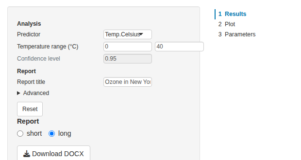
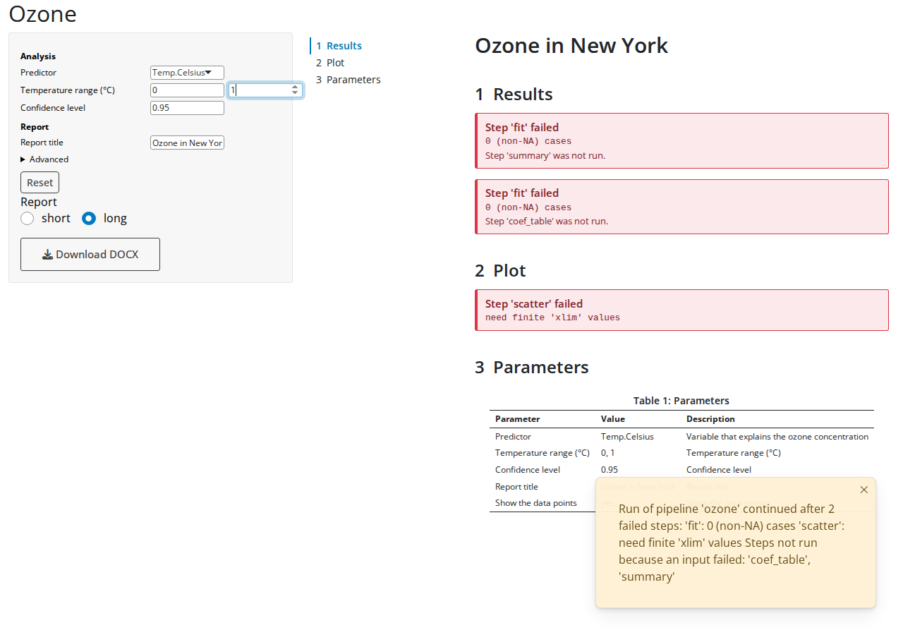

```{r knitr-setup, include = FALSE}
knitr::opts_chunk$set(
    comment = "#",
    prompt = FALSE,
    tidy = FALSE,
    cache = FALSE,
    collapse = TRUE
)

old <- options(width = 100L)
```

[Get started](v01-get-started.html) ended with a small Shiny app, and
[Parameters](v02-parameters.html) described the params that the app shows. This
vignette goes through the app in detail: the parameter UI and what it does with
invalid input, the viewer and how it shows failed steps, two reports from one
pipeline of which the app runs only the one shown, the render cache, and the
two Bootstrap versions. It builds on pipeflow's vignettes
[Pipeline views](https://rpahl.github.io/pipeflow/articles/v03b-pipeline-views.html)
and
[Error handling](https://rpahl.github.io/pipeflow/articles/v05c-error-handling.html).

The code of the app is not run in the vignette, since it needs a browser. The
screenshots come from this very app. Two apps come with pubflow: the report
app combines all of it in an app with a sidebar and adds the download of the
report, the modules app shows what the modules return, locked steps and a
standalone module:

```{r example-apps, eval = FALSE}
shiny::runApp(system.file("examples", "report-app", package = "pubflow"))
shiny::runApp(system.file("examples", "modules-app", package = "pubflow"))
```

## The pipeline

The app shows the ozone analysis of the previous vignettes. The pipeline has
two reports: a short one with the summary and the table of coefficients, and a
long one that adds a plot and the table of parameters. Every section of a report
is a step, tagged with the reports that show it, and the layout step of a report
places the sections of its tag (`pub_layout_inputs()`, see
[Get started](v01-get-started.html)). The config has the params of the
analysis, the title of the reports and an advanced param.

```{r config}
library(pipeflow)
library(pubflow)

config <- param_config(
    xVar = choice_param(
        "Temp.Celsius",
        choices = c("Temp.Celsius", "Wind", "Solar.R"),
        label = "Predictor",
        description = "Variable that explains the ozone concentration",
        area = "analysis",
        source = "user"
    ),
    window = param_group(
        list(
            from = numeric_param(0, label = "From", min = -20, max = 60),
            to = numeric_param(40, label = "To", min = -20, max = 60)
        ),
        label = "Temperature range (°C)",
        area = "analysis",
        source = "user"
    ) |>
        add_validity(\(x) if (x$from < x$to) "" else "'From' must be below 'To'"),
    level = numeric_param(
        0.95,
        label = "Confidence level",
        min = 0.5,
        max = 0.999,
        area = "analysis",
        source = "user"
    ),
    title = param(
        "Ozone in New York",
        label = "Report title",
        area = "report",
        source = "user"
    ),
    showPoints = choice_param(
        "yes",
        choices = c("yes", "no"),
        label = "Show the data points",
        area = "report",
        source = "user",
        advanced = TRUE
    )
)
```

The table, the plot and the table of parameters are made by functions defined
outside of the pipeline, so that the steps don't keep the pipeline's
environment alive (see Get started). A choice reaches a step as a factor, so the
plot converts `xVar` to text before it picks a column with it.

```{r functions}
coef_table <- function(model, level) {
    ci <- confint(model, level = level)
    coefs <- data.frame(
        term = rownames(ci),
        estimate = coef(model),
        lower = ci[, 1L],
        upper = ci[, 2L]
    )
    pub_table(
        coefs,
        caption = sprintf("Coefficients with %g%% confidence limits", 100 * level),
        labels = c(
            term = "Term",
            estimate = "Estimate",
            lower = "Lower",
            upper = "Upper"
        ),
        digits = c(estimate = 3L, lower = 3L, upper = 3L)
    )
}

scatter_plot <- function(data, xVar, showPoints) {
    xVar <- as.character(xVar)
    grDevices::pdf(NULL)
    on.exit(grDevices::dev.off())
    grDevices::dev.control("enable")
    plot(
        data[[xVar]],
        data$Ozone,
        type = if (showPoints == "yes") "p" else "n",
        pch = 19,
        xlab = xVar,
        ylab = "Ozone (ppb)"
    )
    abline(lm(data$Ozone ~ data[[xVar]]), col = "red")
    pub_figure(recordPlot(), caption = "Ozone by predictor", width = 6, height = 4)
}

params_table <- function(pip, xVar, window, level, title, showPoints) {
    # the arguments make the step run again when a reported param changes
    pub_params_table(pub_get_params(pip, source = "user"), caption = "Parameters")
}
```

```{r pipeline}
pip <- pip_new("ozone") |>
    pip_add("data", function(data = airquality) data) |>
    pip_add(
        "prep",
        function(df = ~data, window = list(from = 0, to = 40)) {
            df[, "Temp.Celsius"] <- (df[, "Temp"] - 32) * 5 / 9
            inRange <- df$Temp.Celsius >= window$from & df$Temp.Celsius <= window$to
            df[inRange, ]
        }
    ) |>
    pip_add("fit", function(data = ~prep, xVar = "Temp.Celsius") {
        lm(paste("Ozone ~", xVar), data = data)
    }) |>
    pip_add("coef_table", function(model = ~fit, level = 0.95) {
        coef_table(model, level)
    }) |>
    pip_add("summary", function(model = ~fit, xVar = "Temp.Celsius") {
        pub_text(sprintf(
            "**%s** explains %.0f%% of the variance of the ozone concentration.",
            xVar,
            100 * summary(model)$r.squared
        ))
    }) |>
    pip_add(
        "scatter",
        function(data = ~prep, xVar = "Temp.Celsius", showPoints = "yes") {
            scatter_plot(data, xVar, showPoints)
        }
    ) |>
    pip_add(
        "params_table",
        function(
            xVar = "Temp.Celsius",
            window = list(from = 0, to = 40),
            level = 0.95,
            title = "Ozone in New York",
            showPoints = "yes"
        ) {
            params_table(.self, xVar, window, level, title, showPoints)
        }
    ) |>
    pip_add(
        "results",
        function(summary = ~try(summary), table = ~try(coef_table)) {
            pub_section("Results", summary, table)
        },
        tags = c("short", "long")
    ) |>
    pip_add(
        "plot",
        function(scatter = ~try(scatter)) pub_section("Plot", scatter),
        tags = "long"
    ) |>
    pip_add(
        "parameters",
        function(table = ~try(params_table)) pub_section("Parameters", table),
        tags = "long"
    )
```

The layout steps come last, because `pub_layout_inputs()` reads the tagged
steps when it is called. Their inputs are `~try()` references, so that a step
that fails shows up as an error box in the document instead of stopping it:

```{r layout}
for (report in c("short", "long")) {
    pip_add(
        pip,
        report,
        function(title = "Ozone in New York", ...) {
            pub_doc(unname(list(...)), title = title)
        },
        params = pub_layout_inputs(pip_view(pip, tags = report))
    )
}

invisible(lapply(config, param_validity_assert))
pip_set_params(pip, config, unknown = "error")
```

## The app

The app has the parameter UI in a sidebar and the viewer next to it. A radio
button chooses the report and a button downloads it.

```{r app, eval = FALSE}
library(shiny)

ui <- fluidPage(
    titlePanel("Ozone"),
    sidebarLayout(
        sidebarPanel(
            width = 4,
            pub_params_ui("params"),
            radioButtons("report", "Report", c("short", "long"), inline = TRUE),
            downloadButton("download", "Download DOCX")
        ),
        mainPanel(width = 8, pub_viewer_ui("viewer", height = "85vh"))
    )
)

server <- function(input, output, session) {
    pip <- pip_clone(pip) # every session gets its own pipeline
    cache <- pub_cache()
    params <- pub_pipeline_params_server(
        "params",
        pip,
        group_labels = c(analysis = "Analysis", report = "Report"),
        reset = TRUE
    )

    doc <- reactive({
        params$revision() # run again after every change of a param
        report <- input$report
        withCallingHandlers(
            pip_run(pip_view(pip, step = report), lgr = NULL, on_error = "continue"),
            pipeflow_run_failed = function(w) {
                showNotification(conditionMessage(w), type = "warning")
                message(conditionMessage(w)) # log it
                invokeRestart("muffleWarning")
            }
        )
        pip[[report, "out"]]
    })
    pub_viewer_server("viewer", doc, cache = cache)

    output$download <- downloadHandler(
        filename = \() paste0(input$report, ".docx"),
        content = \(file) {
            req(inherits(doc(), "pub_doc"))
            pub_render(doc(), "docx", file = file, cache = cache)
        }
    )
}

shinyApp(ui, server)
```


The following sections go through the parts of the app.

## The parameter UI

`pub_params_ui()` places the table of inputs and `pub_pipeline_params_server()`
fills it. The server reads the params of the pipeline with `pub_get_params()`
and shows an input for each one (plain function defaults are no params and get
no input). Every value that the user enters is checked against the rules of the
param (see [Parameters](v02-parameters.html)) and, if it is valid, set in the
pipeline with `pip_set_params()`. The pipeline never gets an invalid value.

The type of a param decides on the input: text for strings, a numeric input for
numbers, a select input for factors (or radio buttons with `ui_widget =
"radio"`), a switch for logicals, and a slider with `ui_widget = "slider"`. The
children of a group are shown side by side. The `ui_args` attribute passes
arguments on to the input function, e.g. `ui_args = list(multiple = TRUE)` for
a select input that takes several values. `?pub_param_input` lists them all and
shows how to use a single input in your own UI.

The layout follows the config:

* The rows are in the order of the config.
* The attribute `group_by` (default `"area"`) gives the headings of the
  groups, named by `group_labels`. Without it, or if all params have the same
  value, there are no headings.
* A param with `advanced = TRUE` goes to a collapsed "Advanced" block of its
  group.
* The `description` of a param is shown as a tooltip of its input (with
  `tooltips = FALSE` it is not), and `width` sets the width of the inputs.
* `reset = TRUE` adds a button that sets the inputs back to the values that
  the table started with.

The table is only built again when the structure of the params changes. If a
step sets other values (e.g. defaults that depend on the data), the inputs are
updated in place. To pick this up, give the module a `refresh` argument, a
reactive that changes whenever the params should be read again from the
pipeline.

### Which params are shown

The module shows the params of the pipeline or view that it gets. A view
restricts the table to the params of the steps of the view, here the steps of
the analysis (a view shows the params of its own steps, not those of the steps
they depend on):

```{r view, eval = FALSE}
analysis <- pip_view(pip, step = c("prep", "fit", "coef_table"))
pub_pipeline_params_server("params", analysis)
```

The values still reach every step that has the param, also outside the view
(one value per name, see [Parameters](v02-parameters.html#one-value-per-name)).
With `filter = list(area = "analysis")` the table shows the params with that
attribute only. This is how an app puts the analysis params and the report
params into different places.

### Invalid input

An invalid value is shown next to its input, in a message that goes away after
a few seconds, and the input glows. The message is also written with
`message()`, so it ends up in the log of the app. What happens to the input is
up to `on_invalid`:

* `"restore"` (the default): the input gets back its last valid value.
* `"keep"`: the input keeps the invalid value, which does not reach the
  pipeline, until the user has corrected it. The module's `valid()` is `FALSE`
  in the meantime, so the app can hold back what depends on it.

```{r on-invalid, eval = FALSE}
params <- pub_pipeline_params_server("params", pip, on_invalid = "keep")
```


Text and numeric inputs report their value when the user leaves the input or
presses Enter (`update_on = "blur"`), other inputs immediately. With
`update_on = "change"` they report after every keystroke, after a short delay.

If a group fails a rule of its own, e.g. "From" is not below "To", the input
that the user changed is marked. And if the pipeline itself rejects a value
(`pip_set_params()` fails, because the pipeline holds stricter rules than the
ones the module read), the input is treated like an invalid one and shows the
value of the pipeline again.

### Locked inputs

A param with `locked = TRUE` is shown as a disabled input (see
[Parameters](v02-parameters.html#locked-params)). The module ignores a change
that still reaches it, and the reset button leaves it alone. pipeflow's locks
count too: the params of a step locked with `pip_lock()` are shown as locked,
also in the other steps that hold the same param, because `pip_set_params()`
skips locked steps and a change would leave the steps with different values.

```{r locked, eval = FALSE}
pip_set_params(pip, list(level = numeric_param(
    0.95,
    label = "Confidence level",
    min = 0.5,
    max = 0.999,
    area = "analysis",
    source = "user",
    locked = TRUE
)))
```



### The module without a pipeline

`pub_pipeline_params_server()` is `pub_params_server()` plus the link to a
pipeline. The latter takes a reactive that returns the params, e.g. a config,
and gives you the values:

```{r standalone, eval = FALSE}
params <- pub_params_server("params", reactive(config))
params$values() # the current valid values, as plain values
params$changed() # what changed with the latest valid change
params$valid() # FALSE if an input holds an invalid value (on_invalid = "keep")
```

Use it where the params do not belong to a pipeline, e.g. for the arguments of
a function that you call in the app yourself.

## Running the pipeline

`pub_pipeline_params_server()` returns `revision`, a reactive that counts the
successful changes of the pipeline's params. The reactive that runs the pipeline
depends on it, so that it runs again after every change. `pip_run()` only runs
the steps that are outdated, so a change of the title does not fit the model
again.

The pipeline is a reference object. A change of a param in one session would
also change it for every other session, so `server()` starts with
`pip_clone(pip)`: every session has its own copy.

### Only the steps of the report shown

The reactive runs the view of the report that is shown, `pip_view(pip, step =
report)`, not the whole pipeline. A view runs the step and the steps it depends
on. If the user shows the short report, the plot and the table of parameters
are not made. The step states show it:

```{r run-short}
pip_run(pip_view(pip, step = "short"), lgr = NULL)
pip[, c("step", "state")]
```

Everything of the long report that the short report does not need is still
`new`. Switching to the long report runs the missing steps (`scatter`,
`params_table`, `plot`, `parameters` and the layout step), while the steps of
the short report are not run again.

### Failed steps

Run the pipeline with `on_error = "continue"`. A step that fails does not stop
the run, and the steps that depend on it are not run, but the layout step still
builds the document. It places the failure where the output would have been,
and the viewer shows it as an error box. The run signals one warning for all
failed steps (`pipeflow_run_failed`); the app shows it as a notification and
logs it.

To see this in the app, set the end of the temperature range ("To") to 1: no
row of the data is left, so the model and the plot fail.



If the layout step itself fails, its output is the error, and the viewer shows
it as one box: pass `pip[[report, "out"]]` on as it is, as in the app above. An
error is never embedded silently in a document.

## The viewer

`pub_viewer_ui()` and `pub_viewer_server()` show a document as one scrollable
page, with a table of contents that follows the section being read. The server
takes a reactive that returns the document, `NULL` (shows "No results") or an
error.

* `toc = FALSE` hides the table of contents.
* `height = NULL` lets the viewer grow with the document and the page scrolls.
  With a CSS height, e.g. `"85vh"` as above, the viewer has that height and
  scrolls itself.

The viewer renders the document again as a whole when it changes. Figures and
tables are not made again for that, they come from the render cache.

### The render cache

Rendering a figure takes about 0.1 s, and the viewer would repeat that
for each figure after every change of a param. `pub_cache()` holds the rendered
figures (as files) and the HTML of the tables, and the viewer and the render
functions use it when they get it as `cache`. So a report downloaded after
viewing needs not render its figures again: the app above gives the same cache
to the viewer and to `pub_render()`.

```{r cache, eval = FALSE}
cache <- pub_cache()
pub_viewer_server("viewer", doc, cache = cache)
pub_render(doc(), "docx", file = file, cache = cache)
```

`pub_cache()` is an environment, so it is updated in place. By default it is
kept in a new temporary directory of the R session, `max_entries` limits it (the
least recently used entries and their files are removed beyond that), and
`dir` puts the files elsewhere. A figure is only cached if a step made it:
pipeflow stamps it when the step runs, and the stamp is part of the key. The
cache therefore never shows a stale figure after a step ran again. Make the
cache in `server()`, as above, for one cache per session, or outside of it to
share the entries between sessions.

## Bootstrap 3 and 5

The modules work with Bootstrap 3, which `shiny::fluidPage()` uses, and with
Bootstrap 5, which bslib's page functions use. The app above runs on both by
changing the page:

```{r bootstrap5, eval = FALSE}
ui <- bslib::page_fluid(
    # the same layout as before
)
```

Nothing else changes: the modules bring their own JavaScript and CSS (as an
HTML dependency), also for the tooltips of the inputs. The screenshot of
the failed steps above is a Bootstrap 5 page, the others are Bootstrap 3. The
example apps show both: add `?bs=5` to their URL.

## Where next

* [Get started](v01-get-started.html) shows the workflow in one example,
  [Parameters](v02-parameters.html) the params in depth.
* The help pages of the functions describe the options:
  `?pub_params_ui`, `?pub_param_input`, `?pub_viewer_ui`, `?pub_cache`.

```{r cleanup, include = FALSE}
options(old)
```
